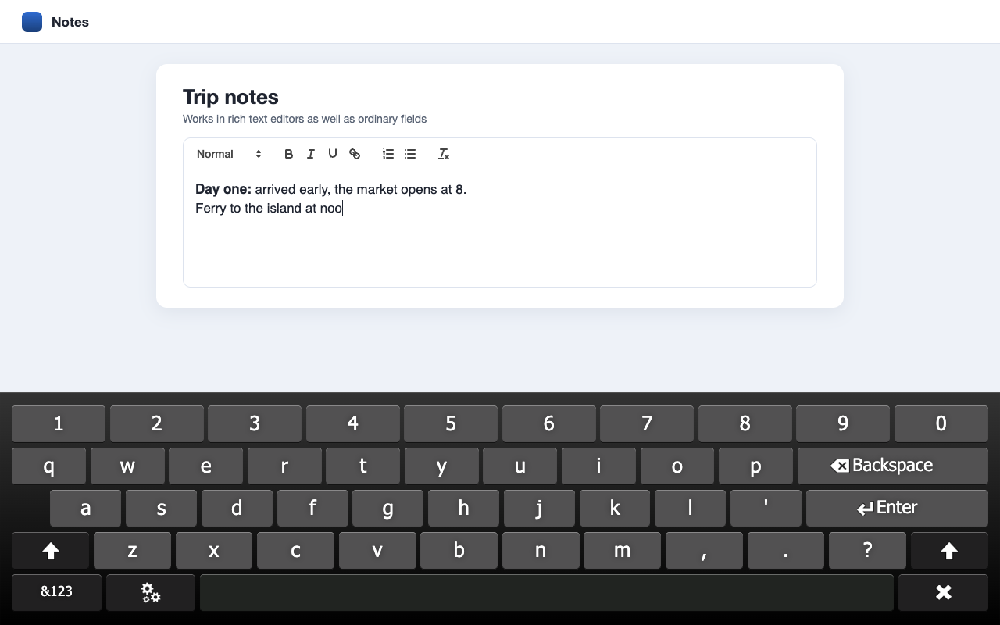

Virtual Keyboard for Google Chrome&trade;
=========================================

## About
Virtual Keyboard for Google Chrome&trade; pops up automatically when you tap a text field, and disappears again once it's no longer needed.

It's made for touch screen devices, kiosks and info points, and works like the on-screen keyboard on a phone or tablet.

## Features
* Types into normal text fields, rich text editors (Quill, CKEditor 5, TinyMCE, ProseMirror / Tiptap, Lexical and other `contenteditable` editors) and fields inside frames, including frames from other sites
* Works with framework-bound fields (Vue, React, Ionic), which receive real input events
* Full-width keyboard or a small floating keyboard you can drag anywhere
* Number pad for phone and number fields, and a numbers and symbols panel
* 15 layouts, switchable from the keyboard
* Auto, toggle or off keyboard modes, from the toolbar button or the settings page
* Keeps the field you're typing in above the keyboard, including inside dialogs
* Optional URL bar for kiosk mode, and a close button on the settings page
* Settings page with a live keyboard preview, light and dark themes

For more details visit: https://apps.xontab.com/VirtualKeyboard/

## Electron
The keyboard works in Electron without the background service worker: settings are read straight from `chrome.storage.local`. Typing into fields inside frames needs the background worker, so it isn't available there.

## Future versions
Planned features are:
* More keyboard layouts
* More developer options

You can also suggest new features: https://apps.xontab.com/Suggest/VirtualKeyboard/

## Privacy
Virtual Keyboard does not collect or send anything you type. See the [privacy policy](PRIVACY.md).
